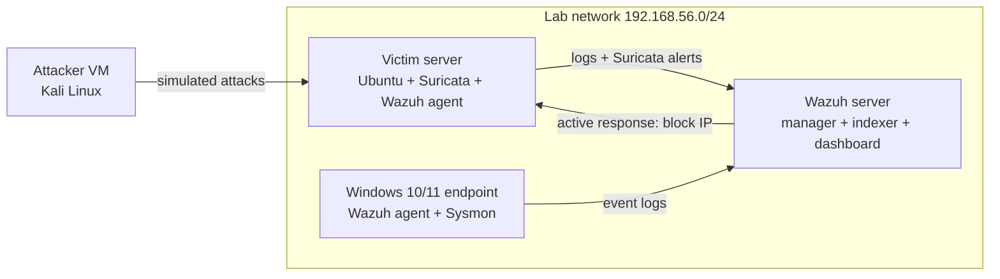

# Wazuh + Suricata Home SOC Lab

> **Status: in progress.** The structure, configs and plan are in place. Screenshots and results are added as each stage is completed (see [Progress](#progress)).

A small security operations centre (SOC) built from scratch on free, open-source tools. It collects logs from several machines, watches network traffic for attacks, raises alerts, maps them to known attack techniques, and can block an attacker automatically.

## In plain words

| Question | Answer |
|---|---|
| **What is it?** | A home lab that copies what a company security team uses to spot and stop attacks. |
| **What does it do?** | Collects logs in one place (**Wazuh**, a SIEM), watches network traffic (**Suricata**, an IDS/IPS), and raises an alert when something suspicious happens. |
| **How was it tested?** | I ran common, safe attack simulations from a separate attacker machine inside the lab and checked that each one was detected. |
| **What came out of it?** | Custom alert rules, automatic blocking of attackers, dashboards, and a short incident report for each test. |
| **Skills shown** | SIEM setup, log collection, intrusion detection and prevention, writing detection rules, MITRE ATT&CK mapping, alert triage, incident reporting, Linux administration. |

## Architecture



Full details: [docs/01-architecture.md](docs/01-architecture.md)

| Machine | Role | OS | Resources |
|---|---|---|---|
| `wazuh-server` | Wazuh manager, indexer and dashboard | Ubuntu Server 22.04/24.04 | 4 vCPU, 8 GB RAM, 50 GB disk |
| `victim-linux` | Web/SSH server, Suricata IDS/IPS, Wazuh agent | Ubuntu Server 22.04/24.04 | 2 vCPU, 2-4 GB RAM |
| `victim-windows` | Windows endpoint, Sysmon, Wazuh agent | Windows 10/11 | 2 vCPU, 4 GB RAM |
| `attacker` | Runs the simulated attacks | Kali Linux | 2 vCPU, 2-4 GB RAM |

All machines run on an isolated host-only network. No attack traffic leaves the lab.

## What was built, step by step

| # | Stage | Guide |
|---|---|---|
| 1 | Plan the lab and network | [01-architecture](docs/01-architecture.md) |
| 2 | Install the Wazuh server | [02-wazuh-server](docs/02-wazuh-server.md) |
| 3 | Connect Linux and Windows machines (agents) | [03-agents](docs/03-agents.md) |
| 4 | Install Suricata as a network IDS | [04-suricata-ids](docs/04-suricata-ids.md) |
| 5 | Send Suricata alerts into Wazuh | [05-suricata-to-wazuh](docs/05-suricata-to-wazuh.md) |
| 6 | Write custom detection rules | [06-detection-rules](docs/06-detection-rules.md) |
| 7 | Run attack simulations and check detections | [07-attack-simulations](docs/07-attack-simulations.md) |
| 8 | Block attackers automatically (active response) | [08-active-response](docs/08-active-response.md) |
| 9 | Switch Suricata to IPS mode (drop bad traffic) | [09-suricata-ips](docs/09-suricata-ips.md) |
| 10 | Dashboards, triage and incident reports | [10-dashboards-and-triage](docs/10-dashboards-and-triage.md) |
| 11 | Results and lessons learned | [11-results-and-lessons](docs/11-results-and-lessons.md) |

## Detection coverage

| Test | What it simulates | Detected by | MITRE ATT&CK | Result |
|---|---|---|---|---|
| Network port scan | Attacker mapping open services | Suricata | T1046 Network Service Discovery | _pending_ |
| SSH password guessing | Brute-force login attempts | Wazuh (auth logs) | T1110.001 Password Guessing | _pending_ |
| Web attacks (SQLi, path traversal) | Attacks against a web app | Suricata + web logs | T1190 Exploit Public-Facing Application | _pending_ |
| File changes in sensitive folders | Tampering / persistence | Wazuh file integrity monitoring | T1565 Data Manipulation | _pending_ |
| New user / sudo misuse | Privilege escalation, persistence | Wazuh (auth logs) | T1136 Create Account, T1548 | _pending_ |
| Suspicious PowerShell | Malicious scripts on Windows | Wazuh + Sysmon | T1059.001 PowerShell | _pending_ |
| Test malware file (EICAR) | Malware dropped on disk | Wazuh FIM (+ VirusTotal, optional) | T1105 Ingress Tool Transfer | _pending_ |
| Automatic blocking | Stop a brute-force attacker | Wazuh active response | Mitigation | _pending_ |

Each result links to its incident report in [reports/incidents](reports/incidents) once the test is run.

## Repository layout

```
docs/                 step-by-step guides (what, why, how, proof)
configs/wazuh/        manager rules, decoders, agent config snippets
configs/suricata/     Suricata config snippets and custom rules
scripts/              setup helpers and lab-only attack simulations
reports/              incident report template and one report per test
screenshots/          proof for each stage (see screenshots/README.md)
```

## Progress

- [ ] Lab network and VMs created
- [ ] Wazuh server installed, dashboard reachable
- [ ] Linux and Windows agents connected
- [ ] Suricata installed and alerting
- [ ] Suricata alerts visible in Wazuh
- [ ] Custom rules written and tested
- [ ] All attack simulations run and documented
- [ ] Active response blocking verified
- [ ] Suricata running in IPS mode
- [ ] Dashboards and incident reports finished

## Safety and ethics

Every attack in this repository was run only against machines I own, on an isolated network with no internet exposure. The simulation scripts refuse to run against addresses outside the lab range.

## Author

**Anmol Chaudhary** · Cybersecurity Analyst · [bustayaga.online](https://bustayaga.online) · [LinkedIn](https://linkedin.com/in/anmolchaudhary01)
